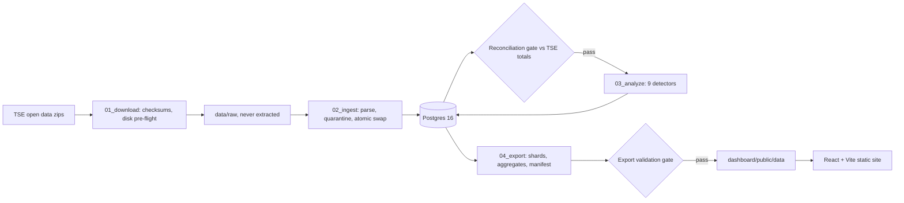

# Brazil 2022 election anomaly observatory

A batch pipeline and a static website that score every voting section of Brazil's 2022 general election against its own local baseline and publish where the results are statistically unusual.

**Status: work in progress.** The pipeline has run over all 27 states and the exterior with every gate green, and the dashboard builds from that export. The public site does not exist yet: deploying it to Cloudflare Pages is the last open task.

## What it is

After the 2022 election, claims circulated about individual voting sections where one candidate took every vote, the "300 × 0" cases. A single section like that says little on its own. In a municipality that votes 90 % one way, a shutout in a 300-voter section is ordinary. The useful question is how improbable a section's result is given how the sections around it voted.

The observatory asks that question for every section, every race and both rounds, using the Tribunal Superior Eleitoral's (TSE) published section-level results. Each flag carries the baseline it was measured against, the sample size and a score or p-value. The design spec sets the stance as a neutral forensic observatory, never a fraud finder and never a debunking exercise.

It is for journalists, researchers and anyone who wants to check a viral claim against the published numbers. The site is bilingual, Portuguese first, with English as a parallel. It runs without a server, so publishing it costs nothing.

## Method and limits

Nine detectors run over the warehouse. The names below are the ones in [`pipeline/src/observatory/detectors/`](pipeline/src/observatory/detectors/).

| Detector | What it measures |
| --- | --- |
| `t1_arithmetic` | Per section, race and round: nominal + party-list + blank + null votes must equal turnout, turnout must not exceed registered voters, and no count may be negative. One point per broken rule. |
| `t1_presence` | A section that reports one race must report every race its state held in that round. The expected races come from the state's own files. |
| `t2_extreme_dominance` | For presidential candidates with at least 1 % of the national vote, the probability of a result at least this extreme under a beta-binomial fitted to the municipality's other sections. Score is `-log10` of the smaller tail. Flagged at 4, a tail probability of 1 in 10,000. |
| `t2_split_ticket` | Round 1, per section: a leading presidential candidate's share minus the federal-deputy share of that candidate's coalition parties, as a robust z-score against the same municipality's sections. Score is `\|z\| / 2`, flagged at 2. |
| `t2_turnout` | Presidential turnout per section as a robust z-score (median and `1.4826 × MAD`) against the municipality's sections. High and low both count. Score is `\|z\| / 2`, flagged at 2. |
| `t2_fingerprint` | Per state and presidential round, a 100 × 100 histogram of turnout against the national winner's share (Klimek et al., 2012), plus the share of sections above 90 % on both axes. No per-section score. |
| `t2_digits` | Second digits of vote counts against Benford's law and last digits against a uniform distribution, chi-square per state and municipality-size bucket. A screen only, with the Deckert et al. (2011) caveats. No per-section score. |
| `t2_urna_model` | Round 2: the Bolsonaro share in pre-2020 voting machines minus the share in 2020-model machines, inside municipalities that ran both, next to the raw national gap. No per-section score. |
| `composite` | The mean of each section's rank percentiles across the five per-section detectors. The top 1 % per round is then tested for clustering by zone and municipality, with a hypergeometric null and Benjamini-Hochberg at q = 0.05. |

A flagged section is a statistical outlier against its baseline and worth a closer look. It is not evidence of fraud. The project's methodology page puts it the other way round too: an absence of flags does not certify that nothing went wrong.

Before any detector runs, the pipeline reconciles what it loaded against TSE's own published municipality and zone totals for every race, with a tolerance of zero. If nominal, party-list, turnout, blank or null totals differ, `02_ingest.py` exits non-zero and the detectors never run. Two categories are recorded but do not stop the run. Votes for candidacies that TSE annulled after the election appear in the section files but not in the official totals. And TSE's candidate rollup sometimes disagrees with its own party rollup. If an annulled candidacy's votes ever showed up as valid, the gate would fail. More than 0.01 % of rows failing to parse also stops the run.

What the data cannot show:

- Anything below a section. TSE publishes totals per voting machine, not ballots.
- Why a section is unusual. Electorate composition, local alliances, administrative aggregation, recording errors and geography are all ordinary explanations the scores cannot tell apart.
- Certainty at this scale. With about 470,000 sections and several comparisons each, some sections score high by chance even if every one followed its model. Only the composite clustering check corrects for multiple testing.
- Small samples well. Small sections give noisy shares, and municipalities with few sections fall back to a state baseline. Each detail row says which baseline it used.
- A verdict on the voting-machine claim. `t2_urna_model` measures how much of the raw gap survives holding the municipality fixed. It does not adjudicate the claim.
- Other elections or demographics. Comparisons with 2018 and 2020 and joins with census data are out of scope for this version.

The full method, in both languages, is in [`dashboard/src/i18n/methodology.en.md`](dashboard/src/i18n/methodology.en.md).

## Where it stands

23 of the plan's 24 tasks are done. The national run finished on 2026-08-06, and every figure below is from [`docs/baselines.md`](docs/baselines.md).

| Measure | Recorded | Budget |
| --- | --- | --- |
| Vote rows loaded | 72,971,593 | about 100 M expected in the spec |
| Sections | 472,075 | |
| Municipalities | 5,751, including the exterior | |
| Rows quarantined | 239, or 0.000328 % | 0.01 % |
| Reconciliation | passed for all 28 members | zero tolerance |
| Exported files | 6,168, 170,548,735 bytes | |
| Municipality shards | 6,130; largest 305,691 bytes gzipped | 307,200 bytes target, 1 MiB hard |
| Deployable directory | 6,175 files; largest file 7.18 % of the cap | 20,000 files, 25 MiB per file |
| Map geometry | 472,506 bytes gzipped | 1.5 MB gzipped |
| Postgres database | 17 GB | |

Ten São Paulo municipalities were too large for one shard and were split by zone automatically. The A4 reconciliation category held 490 annulled candidacies and 2,627,523 votes nationally, none of them counted as valid.

The pipeline produces a Postgres warehouse with an `analysis` schema of per-section scores, then a static export: summary and per-state files, top-500 rankings per detector, a municipality index, one gzipped shard per municipality and a content-hash manifest. The dashboard reads that export. It has a national map, a page per detector, a section-by-section drill-down per municipality and a methodology page with citations.

What remains:

- Deploy to Cloudflare Pages. The production deploy is the owner's action, by hand, following [`docs/deploy.md`](docs/deploy.md).
- Check two hosting behaviours the docs could not settle: whether Pages adds `Content-Encoding: gzip` to `.gz` paths, and whether `_headers` replaces or appends to the default `Cache-Control`. `docs/deploy.md` has the curl steps for both.
- Measure a clean single-pass national run. The recorded run was stopped twice to fix defects, so no end-to-end wall clock exists yet.
- Add a Python linter and typechecker. Neither exists today.

## How it's built



| Path | What lives there |
| --- | --- |
| `pipeline/01_download.py` … `05_pipeline_all.py` | Numbered entry points, one per stage, and the national driver |
| `pipeline/src/observatory/parse.py` | Every TSE file quirk: latin-1, `;`, `#NULO#`, `-1` sentinels |
| `pipeline/src/observatory/reconcile.py` | The reconciliation gate |
| `pipeline/src/observatory/storage.py` | Disk pre-flight and per-state archive reclaim |
| `pipeline/src/observatory/detectors/` | The nine detectors and their registry |
| `pipeline/src/observatory/export/` | Shard encoder, aggregates, manifest, validation gate |
| `dashboard/src/pages/` | Overview, Detector, Municipality and Methodology pages |
| `dashboard/src/i18n/` | Portuguese and English copy, methodology text |
| `data/fixtures/` | Byte-identical TSE excerpts, the TSE-IBGE crosswalk, centroids |
| `docs/` | Design spec, plan with amendments, baselines, deploy runbook |

## Why it's built this way

**The reconciliation gate runs before any detector.** The spec calls it "the standing defense against 'they loaded the data wrong'", and the Makefile states the rule: scoring numbers that have not been reconciled would be publishing an opinion about data the project does not trust. Zero tolerance proved impossible on honest data in Roraima. 22 candidates had section votes but no row in TSE's totals, 27,160 votes or 2.4 % of the comparison, led by a third-placed Senate candidate with 25,554 votes whose candidacy was rejected after the election. The owner kept zero tolerance for keys present on both sides and added a non-fatal `annulled_candidacy` category, which is fatal again if those votes appear as valid. See amendment A4 in the [plan](docs/superpowers/plans/2026-08-04-election-anomaly-observatory-plan.md#execution-amendments-applied-during-implementation).

**Aggregated sections get no exemption.** The plan assumed a section-level column for sections merged into a host section, and exempted them from `turnout ≤ registered voters`. The column does not exist in any of the 29 members of TSE's section-detail archive. TSE folds an aggregated section's voters into its host, and on Roraima, Amapá and Acre the section sums matched TSE's zone totals with zero differences. The exemption was removed, the rule holds unconditionally, and any violation is reported as a finding (amendment A1).

**The voting-machine model comes from the section file, not from correspondence files.** The plan expected to join per-state correspondence archives, with timestamps in their names resolved through TSE's catalogue API, to a separate machine-number table. The section-detail file already publishes `CD_MODELO_URNA`: every one of 472,075 sections has exactly one model code per round. The extra downloads were dropped. The model is not stable across rounds, though. 5,341 sections report a different code in round 2 and 2,080 change generation, so the model is stored per section and round and the detector uses round 2 (amendment A6).

**A party can appear twice in the same zone, so the key carries the coalition sequence.** The national run stopped on Alagoas with a duplicate key in the party rollup. 2022 was Brazil's first general election with party federations, and TSE emits one row per coalition record: 3,665 colliding keys in 10 of 27 states, and none in Roraima, which is why 22 tasks of Roraima runs never hit it. The rows are additive, not duplicates. The key gained `coalition_seq`. Aggregating at ingest was rejected because it throws away a split TSE publishes (amendment A7).

**The site is a static export with content-hashed files and no backend.** The spec requires zero publishing cost, which means a free static host with a 20,000-file and 25 MiB-per-file limit. Drill-down works through one gzipped columnar shard per municipality, with a 300 KB target, and oversized municipalities split by zone. Every data file carries a hash of its own bytes in its name. The manifest is the only mutable file, so a deployment cannot mix files from two exports ([`docs/deploy.md`](docs/deploy.md)). The cost is that a new analysis means a new export and a new upload.

**A national run checks free disk before it downloads anything.** Measured on Roraima, a national run extrapolated to about 28.5 GiB against 22 GiB free, and the budget requires 20 % headroom. The plan treats a breach as a defect, not a number to adjust. The fix deletes each state's archive as soon as it is ingested, so only one is on disk at a time, which brings the estimated peak to about 25.2 GiB. The pre-flight refuses to start without about 30.2 GiB free ([`storage.py`](pipeline/src/observatory/storage.py), [`docs/baselines.md`](docs/baselines.md)).

**Extreme dominance uses a leave-one-out beta-binomial and computes its upper tail by mirroring.** A plain binomial ignores how much sections in one municipality differ, and the module notes it would flag half the country. Leaving the scored section out matters because a 300 × 0 section in a five-section municipality drags the average towards itself. SciPy's survival function failed in the far tail: for n = 300, p = 0.55, k = 300 it returned 5.2e-10 where the true tail is 1.3e-78, so the code evaluates the mirrored CDF instead ([`extreme_dominance.py`](pipeline/src/observatory/detectors/extreme_dominance.py)).

## Run it

Not run here: these commands come from the repo's docs and were not executed for this README. The exception is `docker compose up -d` and `make pipeline UF=RR`, which ran once on a clean checkout on 2026-11-12 and finished with every gate green.

Prerequisites: Docker with Compose for Postgres 16 on port 5432, Python 3.12 with [uv](https://docs.astral.sh/uv/), and Node.js 22.22 or newer with npm, the floor set by React Router 8.3. No paid keys or accounts are needed to run the pipeline.

```sh
docker compose up -d                 # Postgres 16, database "elections"
make pipeline UF=RR                  # one state: download, ingest, reconciliation gate, detectors, export
make test-pipeline                   # pytest, needs Postgres up
cd dashboard && npm ci               # dashboard dependencies
npm run typecheck
npm run test -- --run
npx playwright install chromium      # once, for the smoke test
npm run smoke                        # builds, serves, drives every route in both languages
npm run dev                          # the dashboard over the export in public/data

cd .. && make pipeline-all DRY=1     # national plan and disk budget, no work done
make pipeline-all                    # all 27 states and the exterior
```

A single-state run downloads about 1.1 GB of national archives first, because every presidential section vote lives in the national file (amendment A2). Roraima's ingest measured 312 s cold. A national run needs about 30.2 GiB of free disk before it starts and ends with a 17 GB database. It takes hours: the last 14 states plus analysis and export alone took 24,455.8 s.

`DATABASE_URL` overrides the database, defaulting to the one in `docker-compose.yml`. `DATA_DIR` moves `data/`, and `TEST_DATABASE_URL` points the tests at another database. The Python side has no linter or typechecker.

## Credits and licence

- Election results: Tribunal Superior Eleitoral open data, `resultados-2022`, published under Creative Commons Attribution. The excerpts in [`data/fixtures/tse/`](data/fixtures/tse/README.md) are byte-identical copies of TSE lines, with public candidate and municipality names.
- Municipal boundaries, centroids and names: IBGE's malhas territoriais and localidades APIs, fetched 2026-08-04. They feed [`mun_centroids.csv`](data/fixtures/mun_centroids.csv), the map in [`dashboard/public/geo/`](dashboard/public/geo/README.md) and the crosswalk check.
- TSE-to-IBGE code pairs: the community compilation [betafcc/Municipios-Brasileiros-TSE](https://github.com/betafcc/Municipios-Brasileiros-TSE), repaired and verified against IBGE as described in [`mun_crosswalk_tse_ibge.csv`](data/fixtures/mun_crosswalk_tse_ibge.csv). That repository publishes no licence.
- Map simplification: mapshaper 0.6.111, run as a tool, not shipped.
- Methods: Klimek, Yegorov, Hanel and Thurner (2012); Deckert, Myagkov and Ordeshook (2011); Ridout, Demétrio and Firth (1999).
- npm and Python dependencies keep their own licences, listed in `dashboard/package-lock.json` and `pipeline/uv.lock`.

This project is not affiliated with the TSE or IBGE.

Code: MIT, Copyright (c) 2026 Kevin Shibuya. See [LICENSE](LICENSE).
